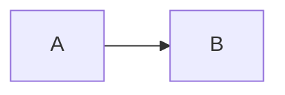

Every README, issue, PR and comment on GitHub is written in **Markdown**: plain text with a few symbols. GitHub's version is called **GitHub Flavored Markdown** (GFM).

## The core

````markdown
# Big title
## Section
### Smaller

**bold**, *italic*, ~~struck~~, `inline code`

- bullet
  - nested bullet
1. numbered

[a link](https://bossgit.dev)


> a quote

```js
console.log("code block with highlighting")
```

| Column | Another |
|--------|---------|
| cell   | cell    |

- [ ] a task
- [x] a done task
````

## GitHub extras

````markdown
> [!NOTE]
> Useful information.

> [!WARNING]
> Something that can break.

<details>
<summary>Click to expand</summary>
Long logs go here.
</details>



Footnote[^1]
[^1]: The note.

@username   #123   owner/repo#45   :rocket:
````

Alerts can be `NOTE`, `TIP`, `IMPORTANT`, `WARNING` or `CAUTION`. Mermaid diagrams and math (`$x^2$`) are drawn by GitHub.

## A README that works

A good README answers, in this order: **What is it? Why? How do I run it? How do I use it? How do I contribute? What is the license?** Add a screenshot or GIF at the top.

```try
echo "# Shop" > README.md
echo "" >> README.md
echo "A tiny online shop built with React." >> README.md
echo "## Run it" >> README.md
echo "npm install && npm run dev" >> README.md
cat README.md
```

```quiz
q: How do you make a checkbox list item on GitHub?
- [] item
- [x] - [ ] item
- (x) item
why: A dash, a space, then [ ] or [x].

q: How do you hide a long log behind a click?
- With a code block
- [x] With <details> and <summary>
why: GitHub supports these HTML tags for collapsible sections.
```

```mission
title: First impressions
goal: Write a `README.md` with a top-level heading `# Weather App` and a section heading `## Install`, and commit it.
setup: mkdir weather && cd weather && git init -q
check: contains README.md # Weather App
check: contains README.md ## Install
check: tracked README.md
check: clean
hint: echo "# Weather App" > README.md, then echo "## Install" >> README.md
solve: echo "# Weather App" > README.md
solve: echo "## Install" >> README.md
solve: echo "npm install" >> README.md
solve: git add .
solve: git commit -m "docs: add README"
```
